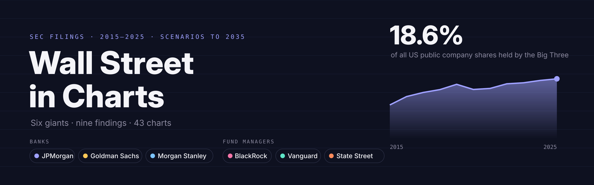
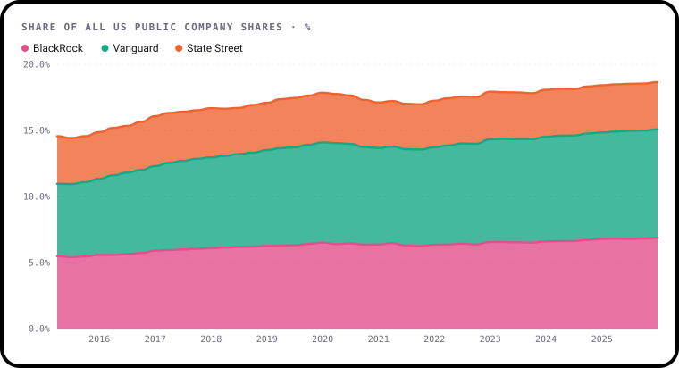

<p align="center">
  <a href="https://shazmoghaddam.github.io/wall-street-in-charts/">
    
  </a>
</p>

# Wall Street in Charts

[](https://github.com/ShazMoghaddam/wall-street-in-charts/actions/workflows/ci.yml)
[](LICENSE)

[](https://shazmoghaddam.github.io/wall-street-in-charts/)

Six Wall Street giants, told through their SEC filings from 2015 to 2025, with forecasts to 2030 and 2035.

- **Banks:** JPMorgan Chase, Goldman Sachs, Morgan Stanley
- **Fund managers:** BlackRock, Vanguard, State Street

**[Read the full report →](https://shazmoghaddam.github.io/wall-street-in-charts/)** One page, nine findings, 43 charts, light and dark.

**Contents:** [Headline findings](#headline-findings) · [How it's built](#how-its-built) · [Data](#data) · [Run it](#run-it) · [Layout](#layout) · [Not financial advice](#not-financial-advice)

> 📈 **Every chart here is drawn with [bezel-charts](https://pypi.org/project/bezel-charts/), an open-source Python
> library created by Shaz Moghaddam, the author of this project.** It turns pandas data into clean, self-contained
> SVG charts in one line. `pip install bezel-charts` · [PyPI](https://pypi.org/project/bezel-charts/) ·
> [GitHub](https://github.com/ShazMoghaddam/bezel-charts)

<!-- findings:start -->
## Headline findings

<picture>
  <source media="(prefers-color-scheme: dark)" srcset="charts/f1-revenue-dark.svg">
  
</picture>

1. **[Who grew biggest](findings/01-who-grew-biggest.md):** JPMorgan's revenue nearly doubled to $182.4bn, but Goldman grew profit fastest (2.8× its 2015 level). BlackRock's AUM tripled to $14.0 trillion.
2. **[Where the banks make money](findings/02-where-banks-make-money.md):** Goldman still earns 71% of revenue from markets; Morgan Stanley now earns most of its revenue (54%) from wealth.
3. **[Where the fund managers invest](findings/03-where-fund-managers-invest.md):** technology rose from 14% to 32% of the Big Three's US shares.
4. **[Choosing or following?](findings/04-choosing-or-following.md):** following. No firm's sector mix was more than 3% away from the market's in 2025.
5. **[Energy](findings/05-energy.md):** oil, gas and coal fell from about 6% to 3% of their holdings; clean energy peaked at just $28.7bn.
6. **[The Big Three's share](findings/06-big-three-share.md):** together they held 18.6% of all US public company shares at the end of 2025, up from 14.9% in 2015.
7. **[Rates rose in 2022](findings/07-rates-and-profits.md):** JPMorgan's net interest income jumped 71% from 2021 to 2023, while Goldman's profit fell 61%.
8. **[Shocks](findings/08-shocks.md):** the pandemic cut JPMorgan's first-half profit by 60%; the 2023 bank failures lifted it 60%.

9. **[Scenarios to 2035](findings/09-scenarios.md):** in the middling case JPMorgan's profit reaches $75.0bn by 2035 (range $49.5bn to $109.5bn). In a backtest trained to 2020, what happened in 2021-2025 fell inside the range 78% of the time. *Not financial advice.*

<picture>
  <source media="(prefers-color-scheme: dark)" srcset="charts/f6-market-share-dark.svg">
  
</picture>
<!-- findings:end -->

## How it's built

- **One pipeline, public sources.** `data/fetch.py` pulls SEC filings (company results, segment figures, earnings releases, 13F holdings and the SEC's bulk 13F data) and FRED series, caches the raw files and writes tidy CSVs.
- **Numbers come from code.** `wallstreet/findings.py` works out every figure. `findings/build.py` writes the charts, the findings pages, the README block above and the report site from them, so the words can never drift from the data.
- **Tests guard the words.** If a data refresh makes a sentence untrue ("nearly doubled", "most sectors shrank"), the tests fail.
- **Forecasts you can rerun.** `models/run.py` fits simple driver models and runs 10,000 Monte Carlo futures with a fixed seed, plus a backtest on 2021 to 2025. CI checks the committed results match a fresh run.
- **Charts** use all 15 [Bezel Charts](https://pypi.org/project/bezel-charts/) types, each in light and dark.

## Data

All from public sources: SEC filings (company results, segment figures, earnings releases and 13F holdings) and FRED (rates and market levels). Vanguard is private, so it is judged on assets under management from its own published figures and on its 13F holdings.

Holdings cover **US-listed shares only**, as reported in 13F filings.

See [`data/README.md`](data/README.md) for every file, column and caveat.

## Run it

```bash
git clone https://github.com/ShazMoghaddam/wall-street-in-charts.git
cd wall-street-in-charts
python -m venv .venv && source .venv/bin/activate
pip install -e ".[dev]"
cp .env.example .env   # add your SEC contact email and FRED API key
python data/fetch.py      # download and tidy the data
python models/run.py      # forecasts and backtest
python findings/build.py  # charts, findings pages, README block and the report site
python assets/build.py    # banner and social preview (needs rsvg-convert)
pytest
```

## Layout

```
data/        fetch script, firm settings, hand-made tables, processed CSVs
wallstreet/  pipeline, findings and chart code
findings/    one page per finding, built by findings/build.py
charts/      every chart as SVG, in light and dark
docs/        the report site (GitHub Pages), built by findings/build.py
assets/      banner and social preview, built by assets/build.py
models/      forecast run script and its outputs (scenarios, backtest, settings)
notebooks/   walk-throughs of the analysis
tests/       unit tests and checks on the data and the findings
```

## Not financial advice

This is an independent data project. Nothing here is investment advice or a recommendation to buy or sell anything. The scenarios to 2035 are illustrations from a simple model, not predictions.

## Licence

[MIT](LICENSE)

---

Created by **Shaz Moghaddam** · London  
[Website](https://shazmoghaddam.github.io/) · [LinkedIn](https://www.linkedin.com/in/shazmoghaddam/)
