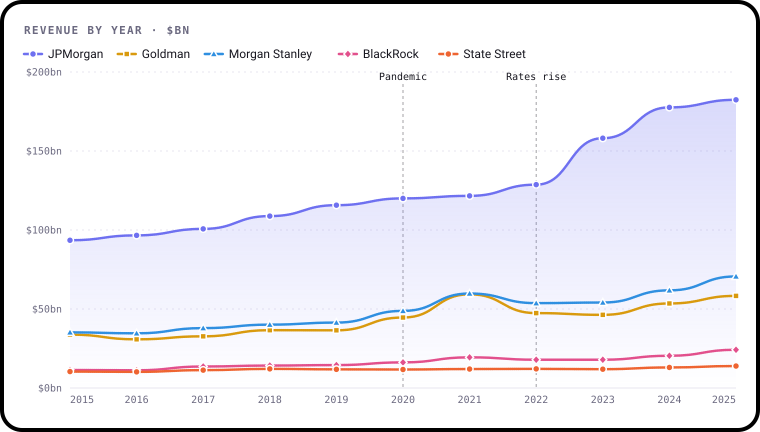
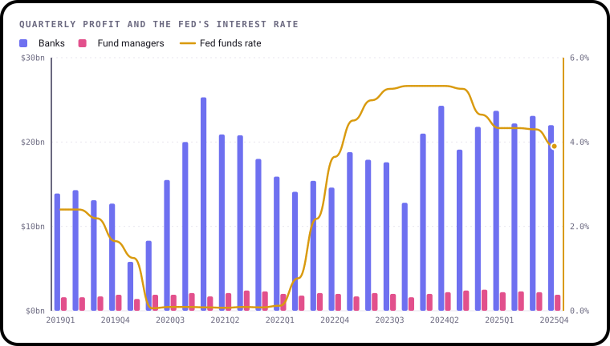

# Wall Street in Charts

[](https://github.com/ShazMoghaddam/wall-street-in-charts/actions/workflows/ci.yml)
[](LICENSE)


Six Wall Street giants, told through their SEC filings from 2015 to 2025, with forecasts to 2030 and 2035.

- **Banks:** JPMorgan Chase, Goldman Sachs, Morgan Stanley
- **Fund managers:** BlackRock, Vanguard, State Street

> **Status:** stage 2 of 5. Data pipeline and history findings are done. Holdings and sectors, forecasts and the report site come next.

> 📈 **Every chart here is drawn with [bezel-charts](https://pypi.org/project/bezel-charts/), an open-source Python
> library created by Shaz Moghaddam, the author of this project.** It turns pandas data into clean, self-contained
> SVG charts in one line. `pip install bezel-charts` · [PyPI](https://pypi.org/project/bezel-charts/) ·
> [GitHub](https://github.com/ShazMoghaddam/bezel-charts)

<!-- findings:start -->
## Headline findings so far

<picture>
  <source media="(prefers-color-scheme: dark)" srcset="charts/f1-revenue-dark.svg">
  
</picture>

1. **[Who grew biggest](findings/01-who-grew-biggest.md):** JPMorgan's revenue nearly doubled to $182.4bn, but Goldman grew profit fastest (2.8× its 2015 level). BlackRock's AUM tripled to $14.0 trillion.
2. **[Where the banks make money](findings/02-where-banks-make-money.md):** Goldman still earns 71% of revenue from markets; Morgan Stanley now earns most of its revenue (54%) from wealth.
3. **[Rates rose in 2022](findings/07-rates-and-profits.md):** JPMorgan's net interest income jumped 71% from 2021 to 2023, while Goldman's profit fell 61%.
4. **[Shocks](findings/08-shocks.md):** the pandemic cut JPMorgan's first-half profit by 60%; the 2023 bank failures lifted it 60%.

<picture>
  <source media="(prefers-color-scheme: dark)" srcset="charts/f7-profit-and-rates-dark.svg">
  
</picture>

Findings 3 to 6 (holdings and sectors) and 9 (forecasts) arrive in later stages.
<!-- findings:end -->

## The questions

1. Who grew biggest: revenue, profit and assets?
2. Where do the banks make their money: trading and dealmaking, wealth management, or lending?
3. Where do the fund managers invest, sector by sector?
4. Do they choose sectors, or just follow the market?
5. Energy then and now: oil, gas and clean energy holdings since 2015
6. How much of the US stock market do BlackRock, Vanguard and State Street hold between them?
7. How did profits move when interest rates rose in 2022?
8. Shocks: 2020, the 2022 rate rises, and the 2023 bank failures
9. Good, middling and bad scenarios to 2030 and 2035

## Data

All from public sources: SEC filings (company results, segment figures, earnings releases and 13F holdings) and FRED (rates and market levels). Vanguard is private, so it is judged on assets under management from its own published figures and on its 13F holdings.

Holdings cover **US-listed shares only**, as reported in 13F filings.

See [`data/README.md`](data/README.md) for every file, column and caveat.

## Run it

```bash
git clone https://github.com/ShazMoghaddam/wall-street-in-charts.git
cd wall-street-in-charts
python -m venv .venv && source .venv/bin/activate
pip install -e ".[dev]"
cp .env.example .env   # add your SEC contact email and FRED API key
python data/fetch.py      # download and tidy the data
python findings/build.py  # charts, findings pages and the README block
pytest
```

## Layout

```
data/        fetch script, firm settings, hand-made tables, processed CSVs
wallstreet/  pipeline, findings and chart code
findings/    one page per finding, built by findings/build.py
charts/      every chart as SVG, in light and dark
notebooks/   walk-throughs of the analysis
tests/       unit tests and checks on the data and the findings
```

`models/` arrives with the forecasts in stage 4.

## Not financial advice

This is an independent data project. Nothing here is investment advice or a recommendation to buy or sell anything.

## Licence

[MIT](LICENSE)

---

Created by **Shaz Moghaddam** · London  
[Website](https://shazmoghaddam.github.io/) · [LinkedIn](https://www.linkedin.com/in/shazmoghaddam/)
