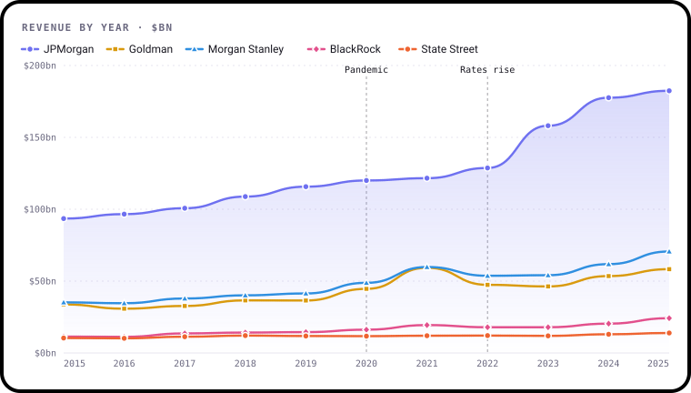
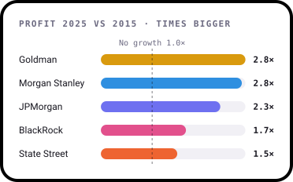
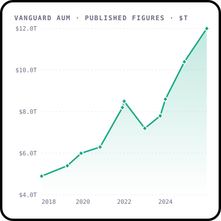
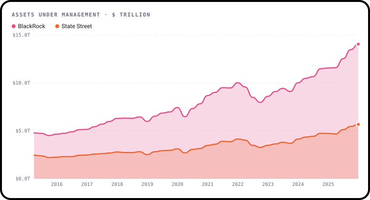
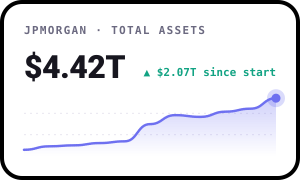
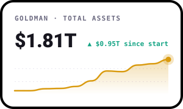
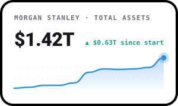

# 1. Who grew biggest?

Revenue, profit and assets for the five listed firms, 2015 to 2025, plus assets under management (AUM) for the three fund managers.

<picture>
  <source media="(prefers-color-scheme: dark)" srcset="../charts/f1-revenue-dark.svg">
  
</picture>

- **JPMorgan is in a league of its own.** Revenue rose from $93.5bn to $182.4bn, more than the other four firms put together.
- **Goldman and Morgan Stanley grew profit fastest.** Goldman's profit is 2.8× its 2015 level and Morgan Stanley's is 2.8×, both ahead of JPMorgan's 2.3×.
- **BlackRock doubled its revenue (2.1×) but profit grew less (1.7×),** so its profit margin narrowed.
- **State Street grew slowest,** with profit up 1.5×.

<picture>
  <source media="(prefers-color-scheme: dark)" srcset="../charts/f1-profit-growth-dark.svg">
  
</picture>
<picture>
  <source media="(prefers-color-scheme: dark)" srcset="../charts/f1-vanguard-aum-dark.svg">
  
</picture>

## Assets under management

BlackRock's AUM tripled, from $4.6 trillion at the end of 2015 to $14.0 trillion at the end of 2025. State Street's grew from $2.2 trillion to $5.7 trillion. Vanguard is private and publishes AUM only now and then; its latest figure is $12.0 trillion.

<picture>
  <source media="(prefers-color-scheme: dark)" srcset="../charts/f1-aum-dark.svg">
  
</picture>

## The banks' balance sheets

<picture>
  <source media="(prefers-color-scheme: dark)" srcset="../charts/f1-assets-jpmorgan-dark.svg">
  
</picture> <picture>
  <source media="(prefers-color-scheme: dark)" srcset="../charts/f1-assets-goldman-dark.svg">
  
</picture> <picture>
  <source media="(prefers-color-scheme: dark)" srcset="../charts/f1-assets-morgan-stanley-dark.svg">
  
</picture>

## Notes

- Revenue for the banks is net of interest expense, the way they report it.
- Profit is net income for the year. AUM is not comparable with the banks' total assets: AUM is clients' money, total assets is the bank's own balance sheet.
- Vanguard's points are only the dates Vanguard (or a press report of Vanguard's figure) published. Gaps are left as gaps. Sources are in `data/manual/vanguard_aum.csv`.
