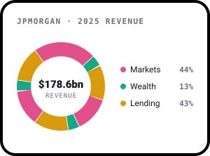
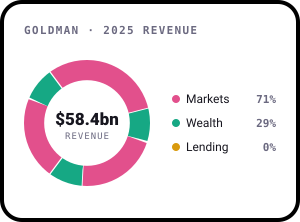
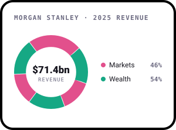
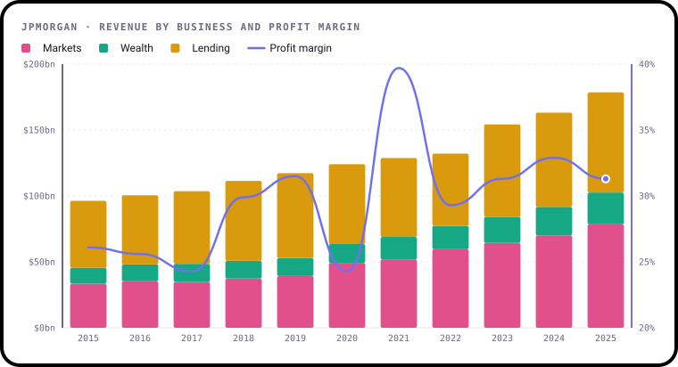
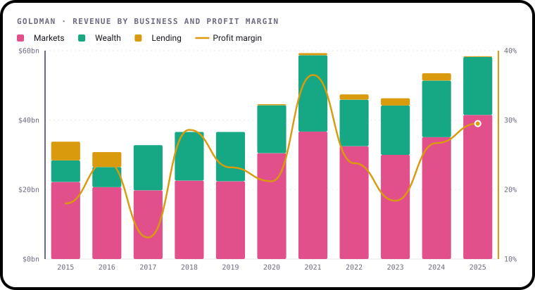
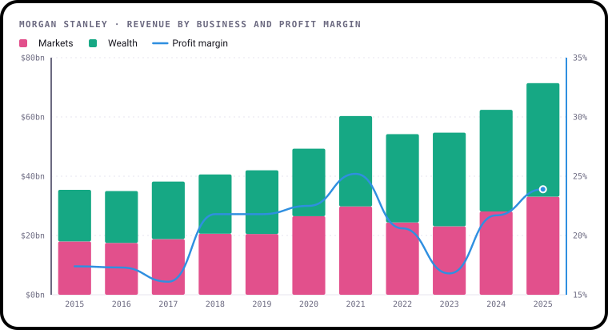

# 2. Where do the banks make their money?

Each bank's revenue split into three kinds of business: **Markets** (trading and dealmaking), **Wealth** (wealth and asset management) and **Lending** (consumer and business banking).

<picture>
  <source media="(prefers-color-scheme: dark)" srcset="../charts/f2-mix-jpmorgan-dark.svg">
  
</picture> <picture>
  <source media="(prefers-color-scheme: dark)" srcset="../charts/f2-mix-goldman-dark.svg">
  
</picture> <picture>
  <source media="(prefers-color-scheme: dark)" srcset="../charts/f2-mix-morgan-stanley-dark.svg">
  
</picture>

- **Goldman is still a markets firm.** 71% of its 2025 revenue came from trading and dealmaking. Its push into consumer banking (Marcus, the Apple Card) is being wound down, and lending is now 0%.
- **Morgan Stanley is now more wealth manager than trader.** 54% of revenue came from wealth and asset management, after buying E*TRADE (2020) and Eaton Vance (2021).
- **JPMorgan is the most balanced:** 44% markets, 43% lending and 13% wealth.

<picture>
  <source media="(prefers-color-scheme: dark)" srcset="../charts/f2-segments-jpmorgan-dark.svg">
  
</picture>

**Regrouping:** from 2022, JPMorgan reports its commercial bank inside the investment bank, so part of its lending moves into Markets from that year. The jump in 2022 is a change of grouping, not of business.

<picture>
  <source media="(prefers-color-scheme: dark)" srcset="../charts/f2-segments-goldman-dark.svg">
  
</picture>

**Regrouping:** Goldman reorganised in 2020 and again in 2022. From 2020 the figures use its current three segments, restated by Goldman.

<picture>
  <source media="(prefers-color-scheme: dark)" srcset="../charts/f2-segments-morgan-stanley-dark.svg">
  
</picture>

## Notes

- Segment figures come from each bank's 10-K. Each year uses the newest 10-K that reports it, so years near a reorganisation use restated figures.
- The mapping from each bank's segment names to the three groups is in `data/manual/segment_map.csv`.
- JPMorgan's segment figures are on its 'managed basis' and leave out its corporate centre, so they add up to slightly more or less than reported revenue.
