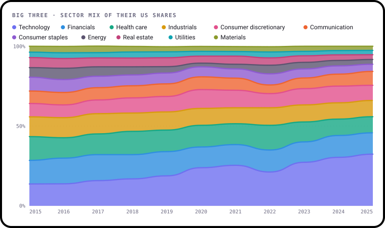
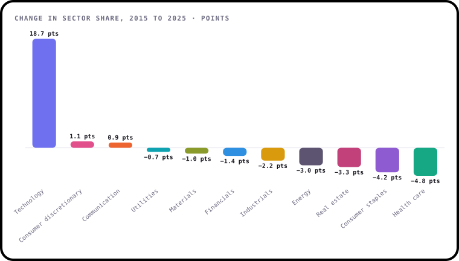

# 3. Where do the fund managers invest?

The sector mix of the US-listed shares that BlackRock, Vanguard and State Street report in their 13F filings, combined, at each year-end.

<picture>
  <source media="(prefers-color-scheme: dark)" srcset="../charts/f3-sector-mix-dark.svg">
  
</picture>

- **Technology took over.** It rose from 14% of the Big Three's holdings in 2015 to 32% in 2025, by far the largest sector.
- **Most other sectors shrank to make room,** above all health care, consumer staples, real estate and energy.
- **They didn't choose this.** It is what happened to the market itself as Apple, Microsoft, Nvidia and the rest grew (see finding 4).

<picture>
  <source media="(prefers-color-scheme: dark)" srcset="../charts/f3-sector-shift-dark.svg">
  
</picture>

## Notes

- **US-listed shares only.** 13F filings leave out bonds, cash, private assets and shares listed outside the US.
- **Sectors** come from each company's SEC industry code (SIC), grouped into 11 sectors close to the GICS sectors index providers use. The largest holdings were checked by hand (`data/manual/sector_overrides.csv`), for example Alphabet and Meta as Communication and Visa as Financials. At least 95% of each firm's value is mapped in every quarter.
- **ETFs** held inside the filings are left out of the mix, since each is a basket of other companies.
