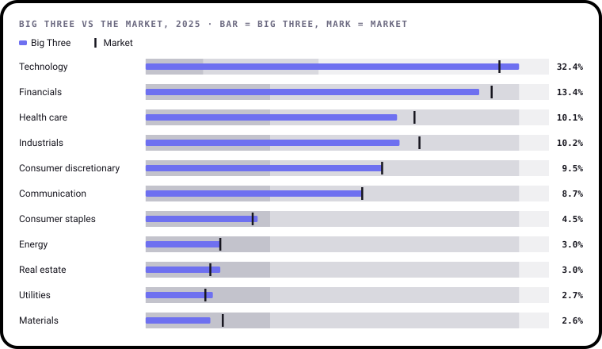
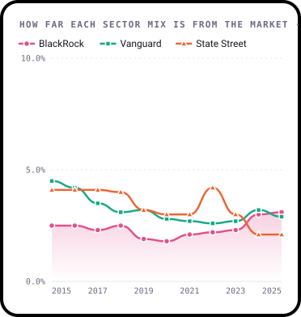

# 4. Choosing, or just following the market?

Each firm's sector mix compared with the 'market': every 13F filer's holdings added up, which is the institutional market (around 4,000 to 9,000 managers a year).

<picture>
  <source media="(prefers-color-scheme: dark)" srcset="../charts/f4-vs-market-dark.svg">
  
</picture>

- **They follow the market almost exactly.** In 2025 no firm's sector mix was more than 3% away from the market's (0% would be an exact copy).
- **The Big Three hold a little more technology** (32% against 31%), most likely because index funds hold the biggest companies in full, while other managers spread more into smaller ones.
- **The one clear tilt was Vanguard's real estate in 2015:** 8% against the market's 5%, from its large property (REIT) index funds.

<picture>
  <source media="(prefers-color-scheme: dark)" srcset="../charts/f4-distance-dark.svg">
  
</picture>

## How the distance is measured

Add up the gaps between a firm's weight and the market's weight in each of the 11 sectors, then halve it. That is the share of the portfolio that would have to move to match the market. 0% is an exact copy; 100% would mean no overlap at all.

## Notes

- The market is built from the SEC's bulk 13F data, one year-end per year. Some filers report in the wrong units; those rows are fixed or left out using a price check against the Big Three's own filings (see `data/README.md`).
