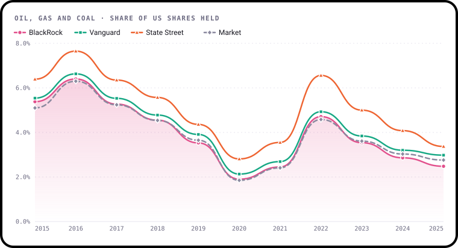
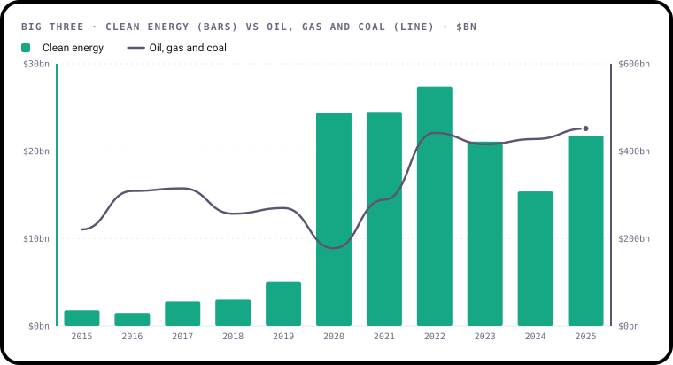

# 5. Energy then and now

Oil, gas and coal companies, and a hand-made list of clean energy companies, in the Big Three's holdings since 2015.

<picture>
  <source media="(prefers-color-scheme: dark)" srcset="../charts/f5-oil-gas-coal-dark.svg">
  
</picture>

- **Oil, gas and coal halved as a share.** BlackRock went from 5% to 2%, Vanguard from 6% to 3% and State Street from 6% to 3%. The market fell the same way (5% to 3%), so this is falling energy share prices and booming tech, not selling.
- **2022 shows it:** energy's share jumped when oil and gas prices spiked after Russia invaded Ukraine, then slid back.
- **Clean energy stays tiny.** The Big Three's clean energy holdings peaked at $28.7bn and were $21.8bn at the end of 2025, against $451.6bn in oil, gas and coal.

<picture>
  <source media="(prefers-color-scheme: dark)" srcset="../charts/f5-clean-vs-oil-dark.svg">
  
</picture>

## Notes

- **Oil, gas and coal** is the Energy sector: producers, oil services, refiners, pipelines and coal, by SEC industry code.
- **Clean energy** is a list of 31 US-listed companies whose main business is solar, wind, geothermal, fuel cells, storage or renewable power, each with a reason (`data/manual/clean_energy.csv`). Big utilities with large renewable fleets, such as NextEra Energy, stay in Utilities because most of their business is still a utility.
- **Tesla is left out** of clean energy on purpose: it is a carmaker, and at its size it would swamp every other name.
