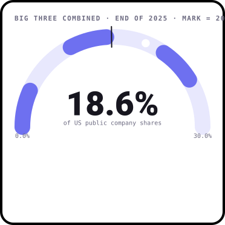
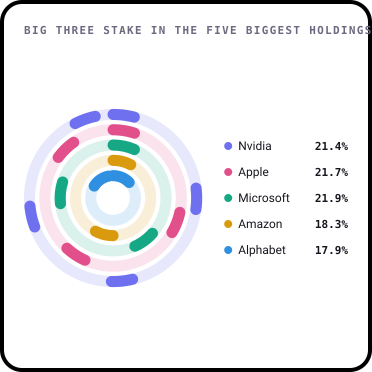
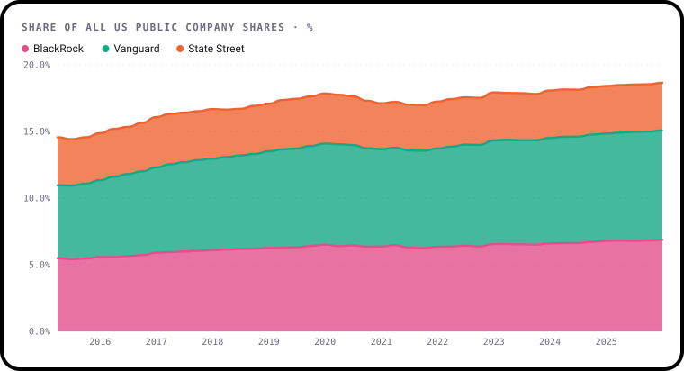
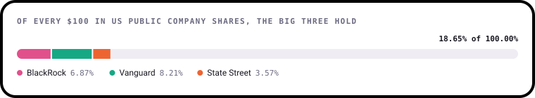
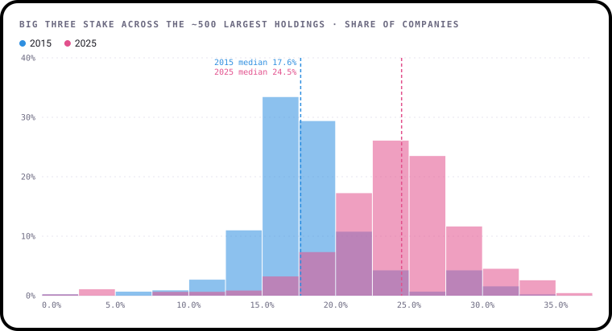

# 6. How much of the US stock market do the Big Three hold?

BlackRock, Vanguard and State Street's holdings of company shares, as a share of the total value of all US public company shares (Federal Reserve figures).

<picture>
  <source media="(prefers-color-scheme: dark)" srcset="../charts/f6-market-share-gauge-dark.svg">
  
</picture>
<picture>
  <source media="(prefers-color-scheme: dark)" srcset="../charts/f6-top-stakes-dark.svg">
  
</picture>

- **Almost a fifth of the market.** Together they held 18.6% of all US public company shares at the end of 2025, up from 14.9% in 2015.
- **Vanguard is the largest** (8.2%), then BlackRock (6.9%) and State Street (3.5%).
- **In the biggest companies the stake is larger.** The typical (median) Big Three stake in their ~500 largest holdings rose from 18% to 24%. They owned more than a fifth of 399 of those companies in 2025, against 97 in 2015.

<picture>
  <source media="(prefers-color-scheme: dark)" srcset="../charts/f6-market-share-dark.svg">
  
</picture>

<picture>
  <source media="(prefers-color-scheme: dark)" srcset="../charts/f6-market-share-split-dark.svg">
  
</picture>

<picture>
  <source media="(prefers-color-scheme: dark)" srcset="../charts/f6-stakes-spread-dark.svg">
  
</picture>

## Notes

- **Market value** is the Fed's figure for all US public companies' shares (FRED series `BOGZ1LM883164115Q`). 13F filings also include some foreign companies listed in the US, so the share is a close estimate rather than exact.
- **Stakes** divide the Big Three's combined shares by each company's shares outstanding from SEC filings. Share classes are added up (Alphabet A and C). Berkshire Hathaway is left out because one class A share is worth 1,500 class B shares. About 7 to 10% of the largest holdings have no usable share count.
- **Holding is not owning outright:** the Big Three hold these shares for the people and pension funds invested in their funds.
