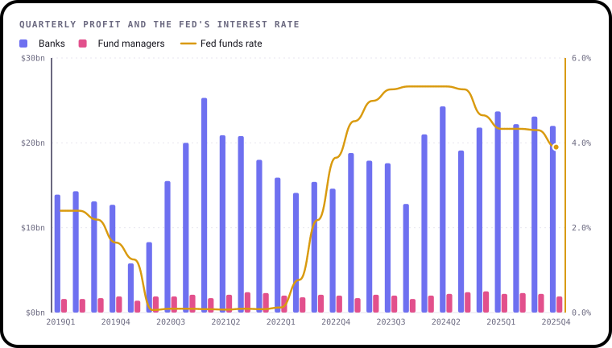
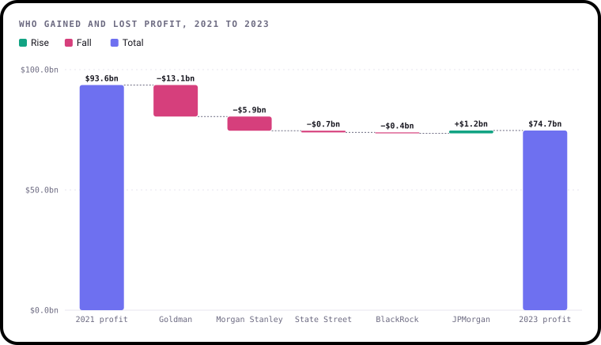
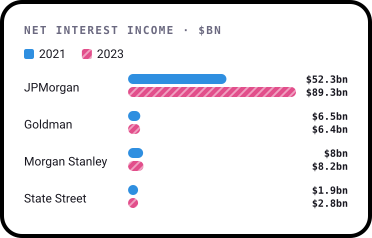
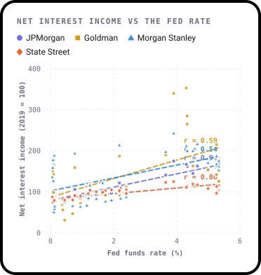

# 7. How did profits move when rates rose in 2022?

The Federal Reserve raised its main interest rate from an average of 0.08% in 2021 to 5.0% in 2023, the fastest rise in forty years. Here is what happened to profit between 2021 and 2023.

<picture>
  <source media="(prefers-color-scheme: dark)" srcset="../charts/f7-profit-and-rates-dark.svg">
  
</picture>

- **JPMorgan's net interest income jumped 71%,** from $52.3bn to $89.3bn. It earned more on loans while paying little more on deposits. Its profit still rose 3% while the others fell.
- **Goldman's profit fell 61%** and Morgan Stanley's 40%. 2021 was a record year for deals; higher rates slowed mergers and share sales, and their interest income barely moved (−2% and +2%).
- **Fund managers felt falling markets, not rates.** BlackRock's profit fell 7% as lower share prices cut its fees. State Street's fell 28%, even though its interest income rose 45%.

<picture>
  <source media="(prefers-color-scheme: dark)" srcset="../charts/f7-profit-waterfall-dark.svg">
  
</picture>

<picture>
  <source media="(prefers-color-scheme: dark)" srcset="../charts/f7-net-interest-income-dark.svg">
  
</picture>
<picture>
  <source media="(prefers-color-scheme: dark)" srcset="../charts/f7-nii-vs-rates-dark.svg">
  
</picture>

## Notes

- Net interest income is interest earned minus interest paid (XBRL tag `InterestIncomeExpenseNet`). BlackRock does not report it.
- In the scatter, each firm's net interest income is indexed to its 2019 average (= 100), so firms of very different sizes share one scale. Each dot is one quarter.
