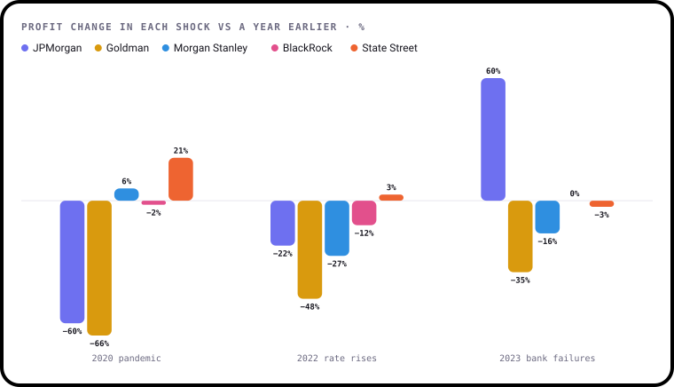
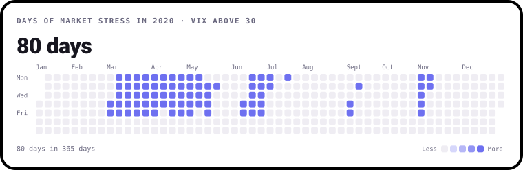
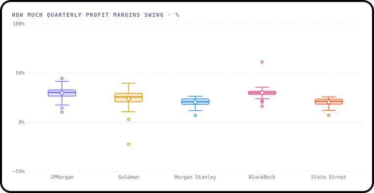

# 8. Shocks: 2020, the 2022 rate rises and the 2023 bank failures

Profit in each shock against the same quarters a year earlier: the first half of 2020, the whole of 2022, and the first half of 2023 (when Silicon Valley Bank, Signature and First Republic failed).

<picture>
  <source media="(prefers-color-scheme: dark)" srcset="../charts/f8-shocks-dark.svg">
  
</picture>

- **The pandemic hit the lenders.** JPMorgan's profit fell 60% and Goldman's 66% as they set money aside for loans that might go bad. State Street's rose 21%, helped by busy markets.
- **2022 hit almost everyone,** led by Goldman (−48%).
- **The 2023 bank failures split the big banks.** JPMorgan's profit rose 60%, helped by higher interest income and by buying First Republic in May 2023. Goldman's fell 35%.

<picture>
  <source media="(prefers-color-scheme: dark)" srcset="../charts/f8-stress-days-2020-dark.svg">
  
</picture>

The VIX, Wall Street's 'fear gauge', closed above 30 on 80 trading days in 2020 and peaked at 83 on 16 March 2020. It did so on 49 days in 2022 and not once in 2023: the bank failures shook banks far more than the wider market.

<picture>
  <source media="(prefers-color-scheme: dark)" srcset="../charts/f8-margin-spread-dark.svg">
  
</picture>

Profit margins by quarter, 2015 to 2025. A taller box means a less predictable business. Goldman swings the most.

## Notes

- Each shock compares the same quarters a year apart, so seasonal patterns cancel out.
- Days of market stress use FRED's daily VIX close (series `VIXCLS`).
