# 9. Good, middling and bad scenarios to 2030 and 2035

> **Not financial advice.** These are illustrations from a deliberately simple model, not predictions or recommendations. The future will not look like any single line here.

Each firm is linked by a simple model to the things that move it: the stock market, interest rates and market volatility. We then run 10,000 simulated futures for those drivers, built from real stretches of history since 1990 (including the 2000, 2008, 2020 and 2022 shocks), and push each one through the firm models. **Bad, middling and good are the 10th, 50th and 90th percentiles** of the results: 1 in 10 futures came out worse than 'bad', and 1 in 10 better than 'good'.

<picture>
  <source media="(prefers-color-scheme: dark)" srcset="../charts/f9-profit-2035-dark.svg">
  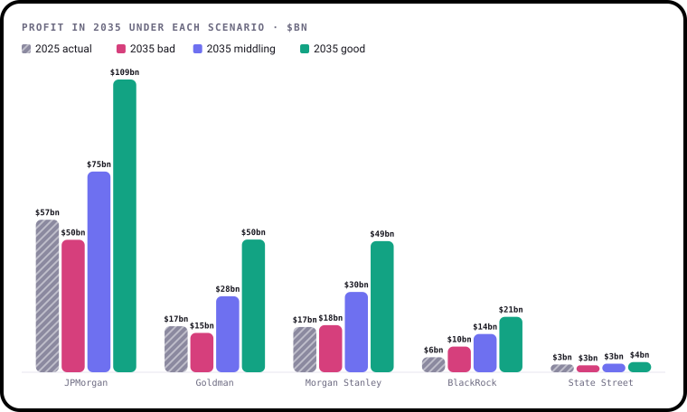
</picture>

- **JPMorgan stays far ahead.** Its 2035 profit comes out at $49.5bn (bad), $75.0bn (middling) and $109.5bn (good), against $57.0bn in 2025.
- **The range is wide, and that is the honest answer.** In the bad case, 2035 profit is below its 2025 level for JPMorgan, Goldman and State Street.
- **Goldman and Morgan Stanley have the widest ranges** relative to their size, because trading and dealmaking swing with markets. Goldman's 2035 profit: $14.7bn (bad), $28.4bn (middling) and $49.6bn (good).
- **BlackRock's AUM** reaches $33 trillion in the middling case (from $14 trillion), with a range of $21 to $49 trillion.

<picture>
  <source media="(prefers-color-scheme: dark)" srcset="../charts/f9-profit-jpmorgan-dark.svg">
  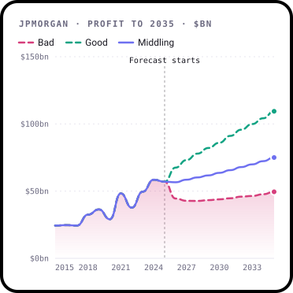
</picture> <picture>
  <source media="(prefers-color-scheme: dark)" srcset="../charts/f9-profit-goldman-dark.svg">
  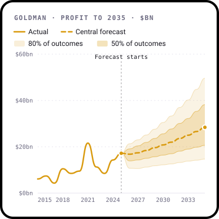
</picture> <picture>
  <source media="(prefers-color-scheme: dark)" srcset="../charts/f9-profit-morgan-stanley-dark.svg">
  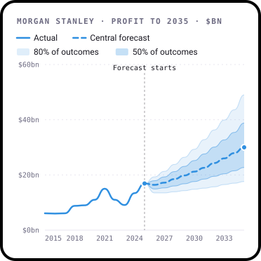
</picture> <picture>
  <source media="(prefers-color-scheme: dark)" srcset="../charts/f9-profit-blackrock-dark.svg">
  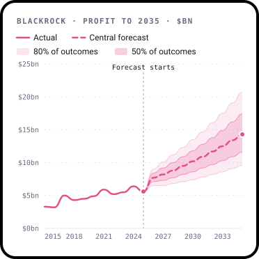
</picture> <picture>
  <source media="(prefers-color-scheme: dark)" srcset="../charts/f9-profit-state-street-dark.svg">
  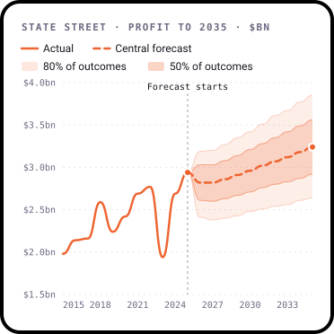
</picture>

<picture>
  <source media="(prefers-color-scheme: dark)" srcset="../charts/f9-aum-blackrock-dark.svg">
  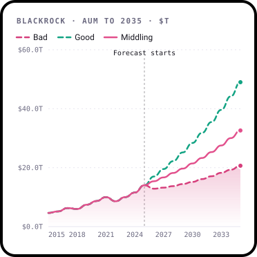
</picture>
<picture>
  <source media="(prefers-color-scheme: dark)" srcset="../charts/f9-aum-state-street-dark.svg">
  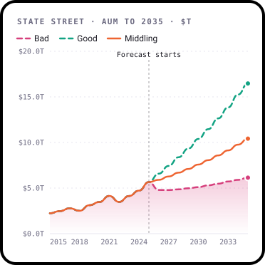
</picture>

## The drivers

In the middling case the US stock market's total value grows about as fast as it did from 1990 to 2025 (about 9% a year, including new listings), reaching 2.4 times its 2025 level by 2035. The bad case is 1.2 times and the good case 4.5 times. The Fed funds rate is pulled back towards its long-run level, about 2% as estimated from 1990-2025, with real surprises along the way.

<picture>
  <source media="(prefers-color-scheme: dark)" srcset="../charts/f9-market-dark.svg">
  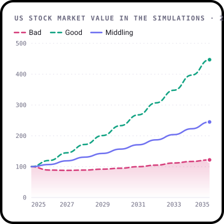
</picture>
<picture>
  <source media="(prefers-color-scheme: dark)" srcset="../charts/f9-rates-dark.svg">
  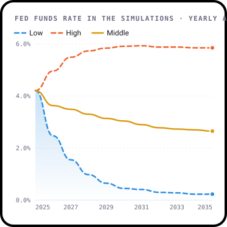
</picture>

## Backtest: how close did it get?

We trained the same models on 2015 to 2020 only, then asked them about 2021 to 2025.

- **With the real market and rates fed in**, yearly revenue was off by 5% to 13% on average. Profit is harder: from 9% for JPMorgan to 38% for Goldman, whose 2021 deal boom and 2023 slump no simple model would call.
- **With everything simulated**, what actually happened landed inside the bad-to-good range 78% of the time. A well-judged 10th-to-90th range should catch about 80%.

<picture>
  <source media="(prefers-color-scheme: dark)" srcset="../charts/f9-backtest-dark.svg">
  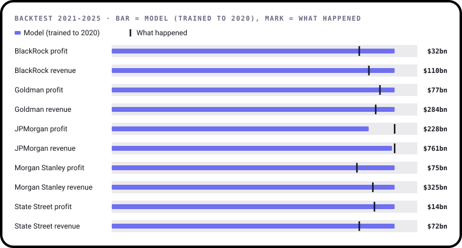
</picture>

<picture>
  <source media="(prefers-color-scheme: dark)" srcset="../charts/f9-backtest-error-dark.svg">
  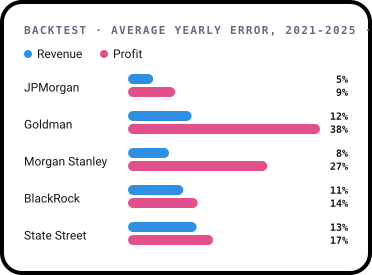
</picture>

## How the models work

- **Banks:** net interest income follows interest rates and the size of the market; other revenue (trading, deals, wealth) follows the market and volatility, with quarter-of-year effects; profit margin follows rates and volatility.
- **Fund managers:** AUM follows the market plus a steady trend (new client money); revenue follows AUM and rates; profit margin follows rates and volatility.
- **Errors are simulated too.** Each model's leftover error persists from quarter to quarter, as it does in real life, so the range reflects how wrong the model has been.
- **Vanguard is left out:** its 11 published AUM figures are too few for a model.
- Everything is in `wallstreet/forecast.py`; outputs and settings (including the fixed random seed) are in `models/`.

## Limits

- Ten years is a long way. Mergers (like BlackRock's 2024 and 2025 deals), new rules or a new business line can change a firm in ways no driver captures.
- 'Good' and 'bad' describe profit and AUM, not whether an outcome is good for anyone else.
- The models are deliberately simple so that every link can be read and checked.
